<div align="center">

# ЧЕКУШКА-МЕЛЛ: МОЙ МИЛЫЙ ПИТОМЕЦ

**Маленький пиксельный сосед. Большой характер. Ваш рабочий стол.**

Человек-бутылка гуляет поверх окон, цепляется за курсор, устраивает перекус<br>
и отвечает на происходящее мемными фразами с анимированным лицом.

[](https://github.com/mikhail-krainev/my-little-chekushka/actions/workflows/build.yml)
[](https://github.com/mikhail-krainev/my-little-chekushka/releases/latest)

[](LICENSE)

**Локально · Без аккаунта · Без нейросетей · Без API-ключей**

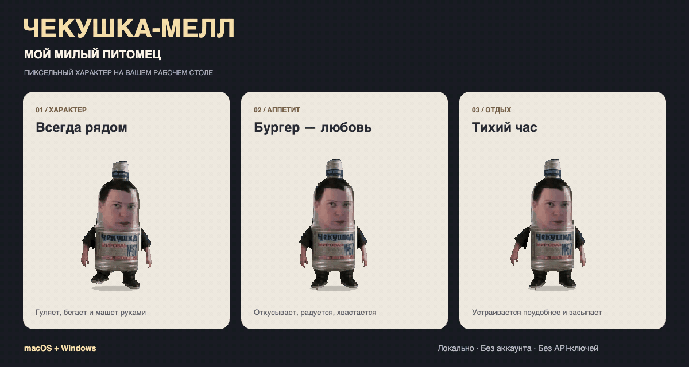

[**Скачать приложение**](https://github.com/mikhail-krainev/my-little-chekushka/releases/latest) · [Что умеет](#что-умеет) · [Галерея](#галерея) · [Запуск из исходников](#запуск-из-исходников)

<sub>18+ · В приложении есть ненормативная лексика, алкоголь и курение.</sub>

</div>

## Знакомьтесь: ваш новый сосед

**ЧЕКУШКА-МЕЛЛ: МОЙ МИЛЫЙ ПИТОМЕЦ** — настольный питомец для macOS и Windows с собственной жизнью и нарочито хулиганским характером. Он сам выбирает занятия, реагирует на файлы и приложения, засыпает, просыпается и периодически напоминает о себе. Любое занятие можно запустить вручную через меню.

Это развлекательное приложение на Electron с пиксельными спрайтами и процедурной анимацией. Подключать модель, оплачивать API или заводить аккаунт не нужно: поведение задаётся локальным кодом, а голос и кадры лица уже входят в приложение.

## Установка

Текущий опубликованный релиз — **v1.2.0**. Выберите установщик для своей системы:

| Система | Скачать |
|:---|:---|
| Windows 10/11, x64 | [Chekushka-1.2.0-win-x64.exe](https://github.com/mikhail-krainev/my-little-chekushka/releases/download/v1.2.0/Chekushka-1.2.0-win-x64.exe) |
| macOS 13+, Apple Silicon | [Chekushka-1.2.0-mac-arm64.pkg](https://github.com/mikhail-krainev/my-little-chekushka/releases/download/v1.2.0/Chekushka-1.2.0-mac-arm64.pkg) |
| macOS 13+, Intel | [Chekushka-1.2.0-mac-x64.pkg](https://github.com/mikhail-krainev/my-little-chekushka/releases/download/v1.2.0/Chekushka-1.2.0-mac-x64.pkg) |

<sub>Ранее опубликованные сборки и технические имена установщиков сохраняют название Chekushka. Новое название проекта и маскота — «ЧЕКУШКА-МЕЛЛ: МОЙ МИЛЫЙ ПИТОМЕЦ». Изменения в исходниках попадают в установщики после выпуска нового релиза.</sub>

### macOS

Для текущей версии на Electron 45 нужен **macOS 13 Ventura или новее**. Минимальная версия соответствует [требованиям Electron](https://www.electronjs.org/blog/electron-44-0).

1. Скачайте `.pkg`: `arm64` для Mac с Apple Silicon, `x64` для Intel. Процессор указан в меню Apple → «Об этом Mac».
2. Откройте установщик и пройдите установку; система может запросить пароль администратора.
3. Запустите **Chekushka** из «Программ» или через Spotlight. Маскот появится на экране, управление — в строке меню. Значка в Dock нет.

Сборка не подписана сертификатом разработчика. Если macOS блокирует запуск, проверьте источник файла; разрешение запуска доступно в «Системные настройки → Конфиденциальность и безопасность». Для движения папок потребуется отдельное разрешение на управление Finder.

### Windows

1. Скачайте `.exe` и запустите установщик. Установка выполняется для текущего пользователя, без прав администратора.
2. После установки питомец запускается автоматически. Для следующего запуска используйте ярлык **Chekushka**.
3. Меню находится в системном трее возле часов; значок может скрываться под стрелкой раскрытия.

Установщик не подписан сертификатом: Windows SmartScreen может показать предупреждение. Перед запуском убедитесь, что файл скачан из релизов этого репозитория.

<details>
<summary><b>Удаление и первый запуск</b></summary>

**macOS:** закройте приложение через его меню, затем переместите Chekushka из «Программ» в корзину. **Windows:** «Параметры → Приложения → Chekushka → Удалить». Локальные настройки могут сохраниться после удаления.

Если маскот не появился, проверьте значок в трее или строке меню. Приложение допускает один обычный экземпляр; закройте предыдущий через «Выход» и запустите снова. Поддержка: [Issues](https://github.com/mikhail-krainev/my-little-chekushka/issues) — укажите ОС, архитектуру, версию приложения и шаги воспроизведения.

</details>

## Что умеет

| Поведение | Как это выглядит |
|:---|:---|
| **Живёт рядом** | Ходит, бегает, приседает, прыгает, садится, чешет голову, делает зарядку и спит на боку. |
| **Играет с мышью** | Прыгает к курсору, повисает на нём, боксирует и может отбросить его. Резкое движение мышью помогает стряхнуть питомца. |
| **Даёт себя схватить** | Перетаскивается мышью, возмущается, размахивает руками. После броска летит по физике и приземляется. |
| **Перекусывает** | Откусывает бургер, радуется и хвастается. С пиццей сложнее: она не откусывается, и коробка летит прочь. |
| **Устраивает проделки** | Заглядывает в окна папок, гонится за перетаскиваемой папкой, двигает папки рабочего стола, пытается печатать в нарисованной поисковой строке. |
| **Показывает характер** | Пьёт из маленькой бутылки или пивной, курит сигарету и кальян, плюётся в экран. После выпивки с вероятностью 50% его тошнит. |
| **Оставляет эффекты** | Разбитые бутылки, осколки, брызги, дым, капли и след от сигареты появляются и исчезают прямо на прозрачном слое. |
| **Говорит** | 68 локальных голосовых фраз; синхронные кадры лица внутри бутылки и текст в облачке. |

Питомец располагается поверх окон на основном дисплее. Прозрачная область пропускает клики: мышь перехватывается только над самим персонажем. На macOS окно сохраняет положение и при показе рабочего стола.

### Реакции на ваши действия

Питомец замечает изменения в `Desktop`, `Documents` и `Downloads`, запуск и закрытие приложений, возвращение после бездействия и взаимодействия с ним самим.

| Событие | Реакция |
|:---|:---|
| Создали папку | «Пошла валютная возня». |
| Что-то появилось в «Загрузках» | Фраза о деньгах и движухе. |
| Открыли мессенджер | Приветствие. |
| Открыли редактор или терминал | Комментарий о работе. |
| Вернулись после трёх минут бездействия | Встречает одной из приветственных фраз. |
| Схватили питомца | Короткое «НО!», затем новые возмущения каждые 3–5 секунд. |
| Выбрали занятие в меню | Запускает действие с соответствующей фразой. |

Обычные автоматические реплики ждут окончания текущей фразы; захват и бросок питомца могут прервать её. У автоматических реакций есть интервалы между репликами; во сне случайные фразы не звучат. Полная карта событий и реплик — в [triggers.mjs](app/src/triggers.mjs), каталог записей — в [phrase-clips.mjs](app/src/phrase-clips.mjs).

Тихие звуки действий синтезируются через WebAudio: шаги, глотки, стекло, хруст еды, храп, зажигалка и бульканье кальяна. Они регулируются отдельно от записанных голосовых фраз.

## Галерея

Медиа ниже создаются **реальным рендерером приложения** из его спрайтов и функций анимации. Это демонстрационные сцены на оформленном фоне, а не запись рабочего стола. Личные окна, папки и документы в них не попадают. GIF без звука: 10 секунд, 15 кадров/с.

### Маленькие привычки

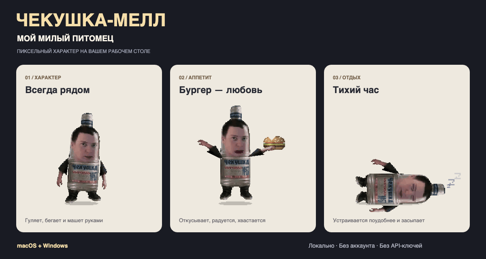

### Большой характер

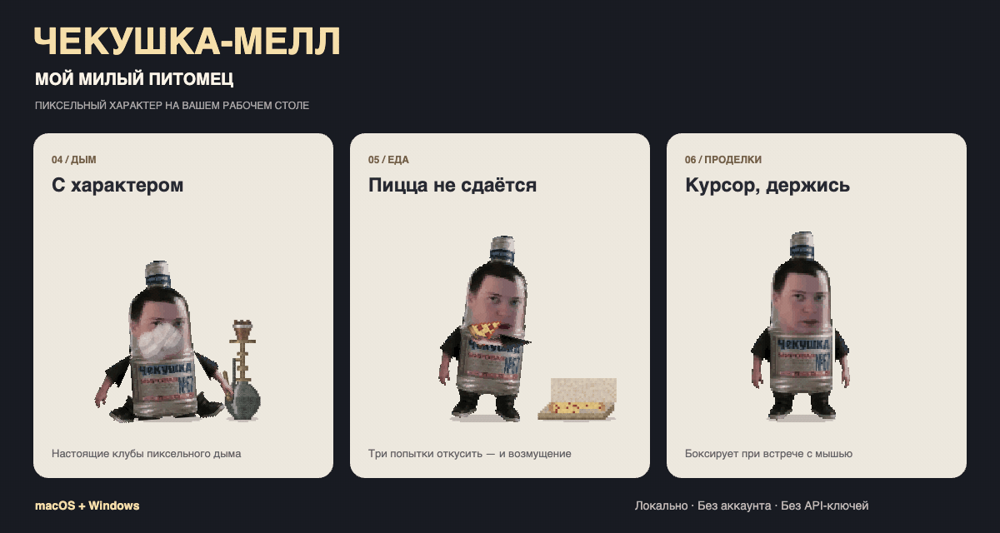

<details>
<summary><b>Статичный кадр: дым, пицца и бокс</b></summary>

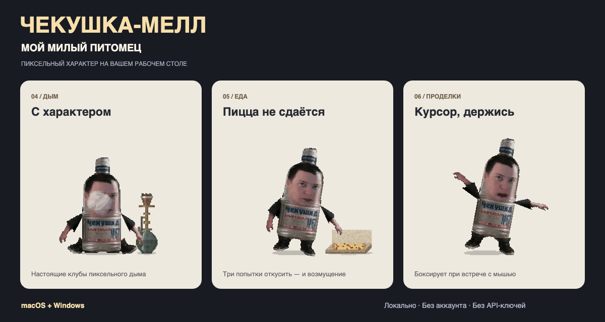

</details>

<details>
<summary><b>Движение и взаимодействие с курсором</b></summary>

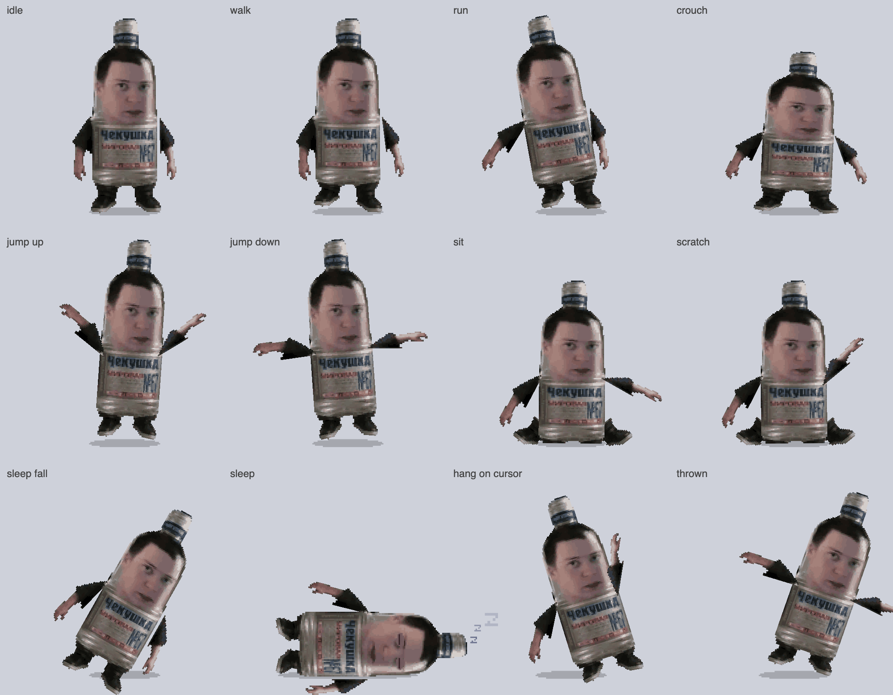

</details>

<details>
<summary><b>Еда и проделки по кадрам</b></summary>

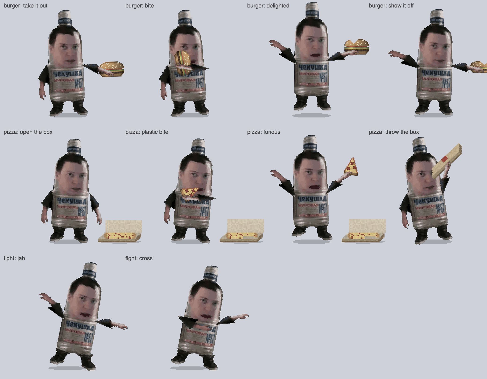

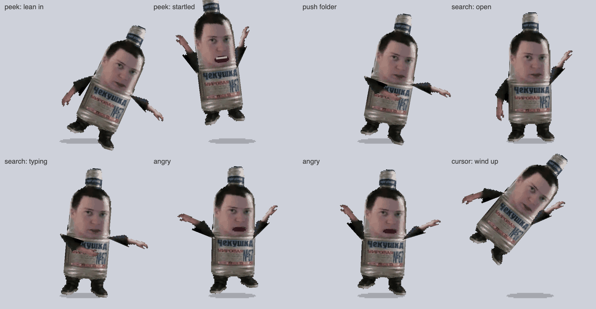

</details>

<details>
<summary><b>Дым, напитки, плевок и стекло</b></summary>

| Сигарета | Кальян |
|:---:|:---:|
| 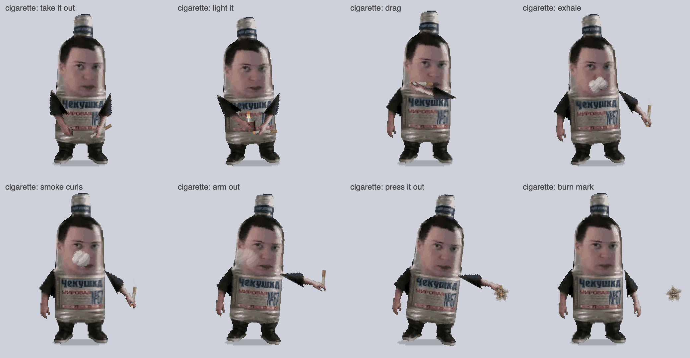 | 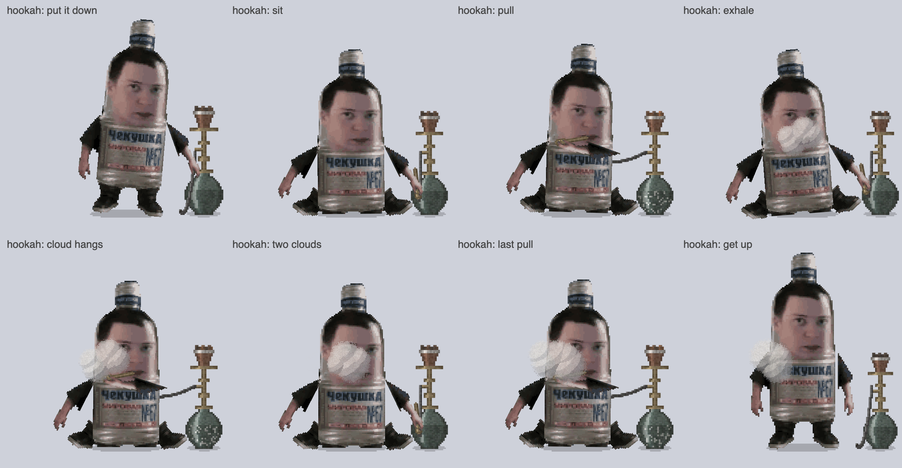 |
| **Выпивка и последствия** | **Плевок** |
| 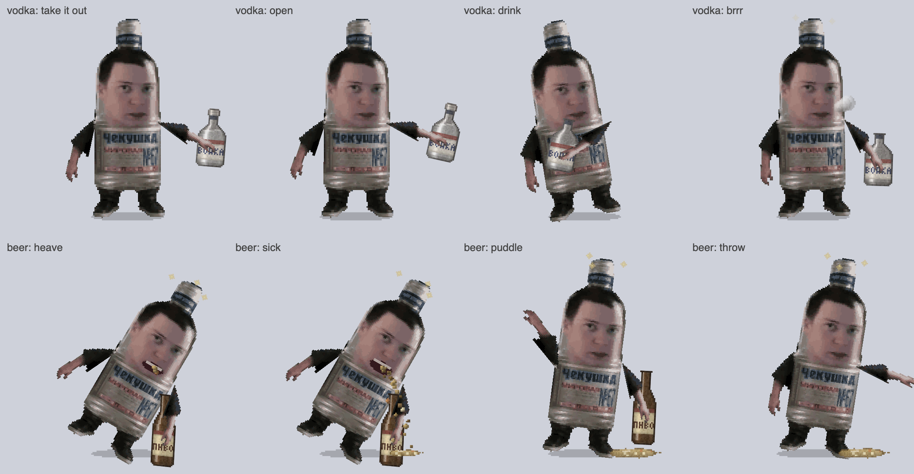 | 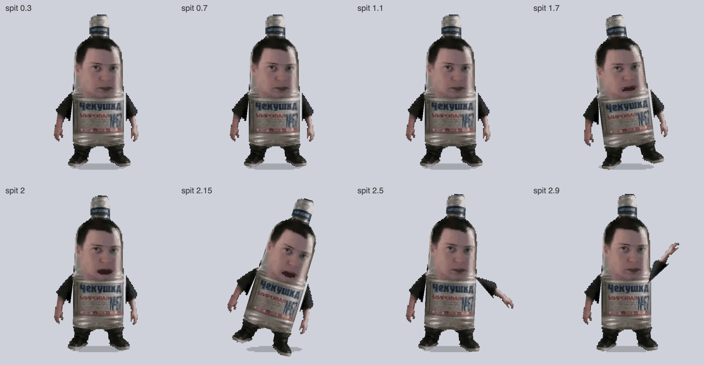 |

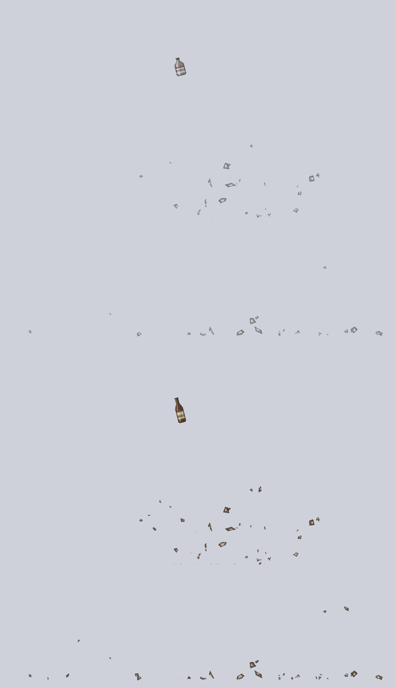

</details>

<details>
<summary><b>Лица из голосовых фраз</b></summary>

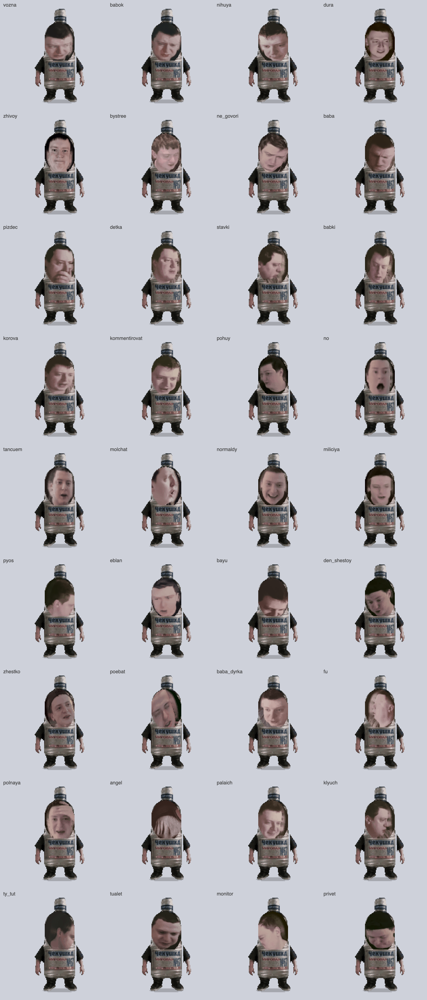

</details>

## Управление

| Действие | Управление |
|:---|:---|
| Случайная фраза | Клик по питомцу или «Действия → Сказать фразу». |
| Перенести или бросить | Зажмите левую кнопку мыши, потащите и отпустите. |
| Открыть меню | Правая кнопка по питомцу либо значок в строке меню / трее. |
| Выбрать занятие | Подменю «Действия». |
| Вернуть сдвинутые папки | «Вернуть папки на место». |
| Закрыть приложение | «Выход». |

В меню отдельно переключаются заглядывание в папки, движение папок, броски курсора, поисковая проделка, драка с курсором и звуки действий. Настройки сохраняются между запусками. Переключатель «Драться с курсором» отключает также раскачивание курсора при перетаскивании питомца.

Все проделки изначально включены. «Подвинуть папку» действительно меняет положение значка папки; «Выкинуть курсор» действительно перемещает системный указатель. Команда возврата восстанавливает сохранённые позиции папок. Поисковая строка нарисована самим приложением.

## Локальная работа и приватность

- Для работы не нужны сеть, аккаунт или облачная модель. Реплики и кадры лица загружаются из файлов приложения.
- Наблюдатель отслеживает изменения файлов в трёх пользовательских папках и названия запущенных приложений. Содержимое документов для реакций не читается.
- Для проделок используются рамки окон Finder / Проводника, имена и координаты папок рабочего стола. На macOS перетаскивание папки распознаётся через системный буфер перетаскивания, а не обычный буфер обмена.
- Переключатели хранятся локально в `settings.json`, исходные позиции папок — в `folder-origins.json` внутри каталога настроек приложения.
- На macOS управление Finder требует системного разрешения. При его отсутствии движение папок недоступно; остальные возможности не требуют этого разрешения.

## Запуск из исходников

Нужны **Node.js 22.12+**, npm и macOS или Windows. Для воспроизводимой установки используйте `npm ci` и приложенный lock-файл.

```bash
git clone https://github.com/mikhail-krainev/my-little-chekushka.git
cd my-little-chekushka/app
npm ci
npm start
```

| Команда из `app/` | Назначение |
|:---|:---|
| `npm start` | Запустить питомца. |
| `npm start -- --demo burger` | После запуска включить выбранное действие. |
| `npm test` | Проверить анимацию, физику, звук, реплики и системные интеграции модульными тестами. |
| `npm run screenshots` | Обновить девять статичных листов в `docs/screenshots/`. |
| `npm run showcase` | Создать презентационные PNG и две GIF; требуется `ffmpeg` в `PATH`. |
| `npm run dist:mac` | Собрать `.pkg` для arm64 и x64 на macOS. |
| `npm run dist:win` | Собрать установщик `.exe` на Windows. |

Режим `--demo` поддерживает: `sit`, `sleep`, `stretch`, `vodka`, `beer`, `spit`, `smoke`, `hookah`, `burger`, `pizza`, `say`, `pushFolder`, `throwCursor`, `search`. Проделки учитывают настройки приложения и доступность системной интеграции.

Генераторы медиа работают в скрытом окне с отдельным canvas: обычное окно питомца, наблюдение за файлами и управление курсором при этом не запускаются. `showcase` временно сохраняет кадры в системный каталог временных файлов, собирает GIF через FFmpeg и удаляет промежуточные кадры. Настройки и значки рабочего стола не меняются.

### Сборка и релизы

[GitHub Actions](.github/workflows/build.yml) запускает тесты на Linux и сборку установщиков на macOS и Windows при push в `main`, pull request и ручном запуске. Теги `v*` дополнительно публикуют установщики в GitHub Releases. Обычный push в `main` сам по себе не выпускает новый релиз.

Для совместимости технические имена `chekushka`, `Chekushka`, идентификатор `com.mikhailkrainev.chekushka` и имена установщиков сохранены. Полное название используется в презентации, заголовке окна и подсказке значка приложения.

## Как устроен проект

```text
app/                          Основное приложение для macOS и Windows
├── main.js                   Прозрачное окно, меню, IPC и системные интеграции
├── preload.js                Изолированный мост к рендереру
├── desktop.js                Окна папок, перетаскивание и позиции значков
├── cursor.js                 Перемещение системного курсора
├── stationary.js             Поведение окна при показе рабочего стола macOS
├── watcher.js                Файловые события и запущенные приложения
├── settings.js               Локальные переключатели проделок
├── screenshots.js            Статичные листы поз и эффектов
├── showcase.js               Презентационные PNG и GIF через FFmpeg
├── src/
│   ├── controller.mjs        Состояния питомца, физика и взаимодействия
│   ├── animator.mjs          Чистые функции «время → поза»
│   ├── renderer.mjs          Отрисовка спрайтов, лица и реквизита
│   ├── smoking.mjs           Сигарета и кальян
│   ├── eating.mjs            Бургер и пицца
│   ├── stunts.mjs            Проделки и бокс
│   ├── shatter.mjs           Физика стекла, капель, дыма и следов
│   ├── sfx.mjs / sounds.mjs  Синтез и расписание звуков действий
│   ├── talk.mjs              Воспроизведение голоса и кадров лица
│   ├── triggers.mjs          Связь событий с репликами
│   └── showcase.mjs          Оформление демонстрационных сцен
├── assets/                   Спрайты, голосовые записи и кадры лица
└── test/                     Тесты на встроенном node:test
macos-native/                 Первоначальная Swift/AppKit-версия, macOS 13+
tools/                        Подготовка спрайтов и голосовых фраз
docs/screenshots/             Медиа для README
```

Основная распространяемая версия — **Electron**. Каталог `macos-native/` содержит отдельную первоначальную реализацию; она не используется workflow сборки установщиков. Логика анимации отделена от отрисовки: одни и те же функции поз используются в приложении, тестах и демонстрационных сценах.

## Участие и лицензия

Ошибки и предложения — в [Issues](https://github.com/mikhail-krainev/my-little-chekushka/issues). Для изменений создайте ветку, проверьте `npm test` и приложите скриншот или GIF, если меняется поведение или внешний вид питомца.

Код распространяется по [MIT](LICENSE) © 2026 Крайнев Михаил. При распространении сохраняйте текст лицензии и указание автора.

Голос и кадры лица в `app/assets/phrases/` взяты из сторонних видеороликов; лицензия MIT проекта не предоставляет права на эти материалы.
